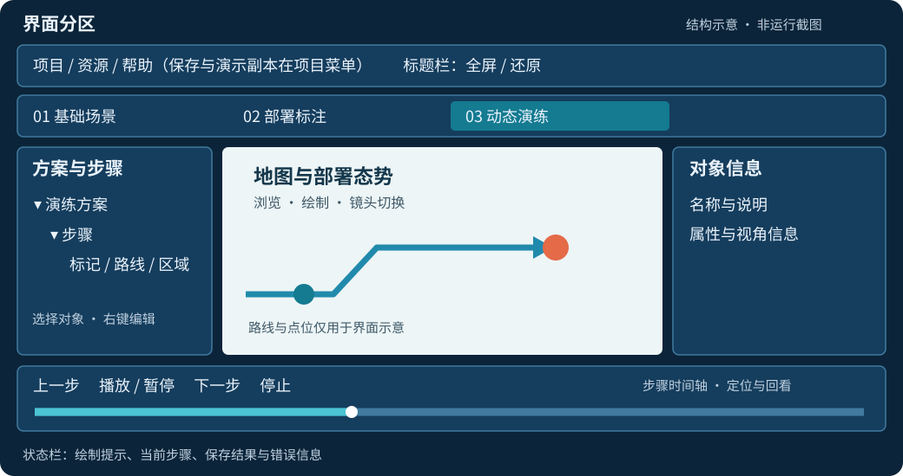

# ShDisplayViewer 使用操作说明书

适用版本：1.0.2 ｜ 公开源码版 ｜ 文档更新：2026-10-13

ShDisplayViewer 用于在地图上编辑部署方案，并按步骤演示事件、行动路线和力量部署。本说明按当前菜单和已实现行为编写，适合方案制作、现场演示和日常维护人员。

**首次使用：先按第 4 章配置底图，再按第 2 章播放示例；制作自己的演练按第 5 章，本地标注按第 8 章。** HTML 版可直接打开，PDF 版便于打印和分发；配置示例使用占位地址，需替换为自己的服务。

## 1. 运行前准备

### 1.1 平台与网络

| 项目 | 说明 |
| --- | --- |
| Windows | x86_64；当前已完成 Release 构建和桌面验证，使用带运行库的完整目录 |
| Ubuntu | 22.04 及以上、x86_64 为目标；已完成 Release 构建、自动测试和 Ubuntu 22.04 桌面冒烟验证，跨机器部署仍待验证 |
| 图形环境 | 地图需要可用的桌面 OpenGL 驱动；虚拟机或远程桌面环境需另行确认 |
| 登录与权限 | 不需要 IMS、登录或激活；没有用户角色权限配置 |
| 本地工作 | 编辑、保存和步骤演练使用本地数据；离线地图需自行准备可用的数据和配置 |
| 主动联网 | 在线地图、RTSP 和网页需要服务可达；服务自身的认证与访问限制仍然适用 |

运行目录应放在当前用户可写的位置。不要只复制 EXE，也不要删除同目录 DLL、插件或 Data。缺少地图或视频组件时，相应功能不能正常使用。

### 1.2 启动与项目位置

Windows 双击完整运行目录中的 `ShDisplayViewer.exe`。Ubuntu 已安装桌面快捷方式时，双击“ShDisplayViewer-三维地图演练系统”；也可在完整运行目录执行 `bash run.sh`。源码工程分别使用 `scripts/Run-Windows.cmd` 或 `bash scripts/run-ubuntu.sh`。

公开源码模板不包含现场地图、高程和缓存。首次运行是空白离线地球，配置自己的合法地图源后才会显示对应影像。若使用完整运行包，请保留包内全部目录；Ubuntu 可执行 `bash install-desktop.sh` 为当前解压位置安装快捷方式。地图服务仍须可达，缓存只覆盖实际加载过的区域与级别。

`bash` 是执行 shell 脚本的解释器，`run.sh` 会设置所需运行库路径并启动程序。Ubuntu 建议使用快捷方式或该脚本，避免直接双击二进制时找不到库；路径含空格时用英文双引号包住整个路径。桌面提示“不受信任”时，在确认文件来自本部署包后使用“允许启动”。

启动时项目选择顺序为：

1. 命令行 `--project` 指定目录。
2. 程序同目录的项目，须有 `shdisplay-project.json`。
3. 仅当程序旁没有项目清单时，使用程序目录下的 `Projects/default`。

启动后默认选中“01 基础场景”。地图缓存和其他生成数据也跟随程序目录，具体目录见第 9.4 节；运行目录不可写时会提示调整位置。

典型项目目录：

```text
项目目录/
├── shdisplay-project.json
└── Data/
    ├── Config/         演练、标记、图层与环境配置
    ├── earth/          地图入口及服务模板
    ├── model/          模型与航线配置
    └── assets/         通过界面导入并登记的资源
```

也可通过命令行启动指定项目：

```bat
ShDisplayViewer.exe --project "C:\Exercises\MyProject"
```

```sh
./ShDisplayViewer --project "$HOME/Exercises/MyProject"
```

切换项目后，编辑和保存都作用于所打开的项目。项目是包含清单及数据的**目录**，不是单独的 XML 文件。

## 2. 快速开始：播放青岛仓库火灾示例

### 2.1 找到或导入方案

1. 启动程序，进入上方“03 动态演练”。
2. 在左侧选择“示例：青岛仓库火灾协同处置（虚构）”。
3. 若没有该方案，使用“项目 → 导入 Qt 动态标记 XML…”。
4. 选择含示例 XML 的 `examples/warehouse-fire` 目录。
5. 选择另一个空目录保存独立项目。导入后打开新项目，再配置自己的底图。

导入创建新项目，不会合并到原项目。清洁构建的默认项目可能只有“示例：集结、部署、处置”三步骤方案，也可以先用它练习播放。

### 2.2 播放与观察

点击下方“播放”。火灾示例位于山东省青岛市地图范围，覆盖约东西 22 公里、南北 13 公里；共 8 个阶段、30 个标记，展示时间约 2 分 30 秒。每步第一个标记设有对应区域与尺度的视角，步骤切换时会飞行到相应视角。

| 阶段 | 主要显示内容 |
| --- | --- |
| 01 发现报警 | 火点、仓库轮廓、关注区域、上报点 |
| 02 疏散接应 | 疏散箭头、集合点、门岗接应和人员核对 |
| 03 首批力量前往 | 首批出发点、进场路线、途中节点、到场位置 |
| 04 到场部署 | 指挥、作业、供水核验和入口秩序维护 |
| 05 请求增援 | 需求上报、支援出发、增援路线和途中节点 |
| 06 增援协同 | 集结交接、医疗协同、装备保障和信息汇总 |
| 07 火情控制 | 阶段状态更新、复核及后续看护 |
| 08 清点复盘 | 人员、装备清点和演练复盘 |

可暂停讲解，用“上一步”“下一步”或时间轴回看。名称中的阶段编号用于区分历史记录；先前阶段的标记会保留，出发点与到场点不代表两支队伍。

场地、路线和处置情景均为虚构。路线表达前往和支援过程，不提供真实导航、车辆连续移动或火势仿真；播放时间也不是现场响应时限。详细讲解见[火灾示例说明](../examples/warehouse-fire/README.md)。

## 3. 认识界面



| 区域 | 用途 |
| --- | --- |
| 项目菜单 | 新建、打开、保存项目（Ctrl+S）、导入导出、进入/退出演示副本；演示副本期间菜单项显示勾选 |
| 蓝色标题栏 | 两个平台共用；最小化、窗口全屏/还原、关闭，双击标题栏也可切换全屏 |
| 01 基础场景 | 图层、固定标记及基础空间信息 |
| 02 部署标注 | 普通本地部署标注与关联动作 |
| 03 动态演练 | 方案、步骤、动态标记及演练播放 |
| 左侧树 | 选择对象，右键编辑；可展开方案和步骤 |
| 中央地图 | 地图浏览、绘制标记、展示路线和部署态势 |
| 右侧信息区 | 查看选中对象的说明与相关属性 |
| 下方控制与时间轴 | 播放、暂停、停止、切换步骤和定位进度 |
| 状态栏 | 当前操作提示、保存结果和错误信息 |

地图通常可通过左键拖动平移、滚轮缩放；旋转、俯仰等操作以当前地图组件的交互设置为准。处于绘制模式时，鼠标用于放置控制点，请优先阅读状态栏提示。

## 4. 基础场景：系统图层与地图配置

### 4.1 先分清三类图层

进入“01 基础场景”，展开左侧树。当前界面直接列出“系统图层”“自定义图层”等节点，不需要寻找旧客户端的“图层”父节点。

```text
基础场景
├─ 系统图层
│  ├─ 地图配置图层       来自当前 .earth
│  └─ 系统矢量图层（N）  来自 featureConfig.xml
└─ 自定义图层
   ├─ 影像图层
   ├─ 高程图层
   └─ 矢量图层
```

| 要做的事 | 操作位置与文件 | 保存内容 |
| --- | --- | --- |
| 配置“系统图层”中的底图、地形服务 | `systemConfig.xml` 指向的 `.earth`；见 4.2～4.4 | 图层定义及服务地址在 `.earth`，界面显隐/不透明度快照在 `fixed-spatial.xml` |
| 添加国境线、省市界、地名等系统矢量 | `Data/Config/featureConfig.xml`；见 4.8 | 定义和样式在该文件，界面显示状态由兼容快照保留 |
| 不改 .earth，直接在界面叠加一个图层 | “自定义图层”；见 4.6 | `Data/Config/customLayerConfig.xml` |

**界面新增 TMS 会进入“自定义图层”，不会自动写入“系统图层”的 .earth。** 系统图层可取消勾选隐藏；不能在树中用“删除”修改其定义。移除系统地图层应修改实际使用的 .earth，移除系统矢量应修改 featureConfig.xml，再重新打开项目。

### 4.2 找到实际使用的地图配置

1. 确定当前项目目录：程序默认读同目录项目；如果通过“打开项目”、`--project` 或演示副本切换过，配置属于切换后的项目。
2. 用文本编辑器打开该项目的 `Data/Config/systemConfig.xml`，找到 `<common>` 的 `earth` 属性。
3. 根据下表找到真正的 .earth 文件。**不要凭文件名认定程序一定使用某个固定 .earth。** 公开模板默认使用 `FreeEarth_flat.earth`。

| earth 示例值 | 查找位置 |
| --- | --- |
| `earth/FreeEarth_flat.earth` | 公开模板默认入口，位于当前项目 `Data/earth/FreeEarth_flat.earth` |
| `earth/Earth_flat.earth` | 自行改名后的示例，须同步修改主配置并提供该文件 |
| `earth/examples/HttpTms.earth` | 当前项目 `Data/earth/examples/HttpTms.earth` |
| 本机的完整绝对路径 | 直接打开该路径；它可能在程序目录之外 |

例如以下是原节点的字段示意，修改时保留自己原有的其他属性：

```xml
<common earth="earth/FreeEarth_flat.earth" title="ShDisplayViewer"/>
```

推荐的 `earth/...` 相对路径以项目 **Data** 为基准，不以 `Data/Config` 为统一基准。`.earth` 内的本地 `<url>` 相对路径通常以 **该 .earth 所在目录** 为基准。示例：`.earth` 位于 `Data/earth/`，数据位于 `Data/assets/world.tif`，则该图层的 URL 写 `../assets/world.tif`。

通过自定义图层添加本地数据时，URL 相对路径由驱动按启动工作目录读取。若文件放在程序旁的 `map/my-elevation`，URL 可以写 `map/my-elevation`；这只是目录布局示例，公开源码不提供该数据。Ubuntu 使用 run.sh，Windows 快捷方式的“起始位置”应设为程序目录。Linux 文件名区分大小写；瓦片格式、坐标系、行方向和级别必须按自己的数据填写。

手工修改前退出程序并备份将要编辑的 XML/.earth。项目导出不自动收集外部地图文件及地图瓦片，必要的外部文件应另外保存。若设置了 `SHDISPLAY_EARTH_FILE`，它会优先于主配置；先检查是否存在这个环境变量。

### 4.3 配置系统 TMS 影像底图

TMS 使用 XML 元数据描述瓦片格式、坐标系和级别，再按元数据访问瓦片。建议填写明确的 `tms.xml` 或 `tilemapresource.xml` 地址，避免把目录网页当成地图元数据。依据：[osgEarth TMS 文档](https://docs.osgearth.org/en/latest/tms.html)。

1. 向地图服务提供方取得元数据地址；浏览器打开后应看到 `TileMap` 等 XML 内容，而不是管理页面、登录页面或错误提示。
2. 关闭 Viewer，打开 4.2 确认的 .earth。若它已有图层，将下面的 `TMSImage` 加入已有 `<map>` 内；不要把整个现有文件替换掉。
3. 把示例 URL 换成真实地址。若使用 `Data/earth/examples/HttpTms.earth` 模板，移除所需图层外的 `<!-- ... -->` 注释；注释中的图层不会加载。
4. 保存 UTF-8 文件，启动 Viewer，进入“基础场景 → 系统图层 → 地图配置图层”，检查新图层名称，勾选显示。
5. 在图层“属性”中检查不透明度，首次验证设为 100%。用“视角 → 视点定位”定位到服务覆盖区域，观察影像是否出现并可正常缩放。

以下为独立的最小地图文件示例，适合另建 .earth 后选择加载：

```xml
<?xml version="1.0" encoding="UTF-8"?>
<map name="演练底图" type="geocentric" version="2">
  <options><lighting>false</lighting></options>
  <TMSImage name="HTTP TMS 底图">
    <url>https://maps.example.invalid/TMS/WGS84/tms.xml</url>
  </TMSImage>
</map>
```

`example.invalid` 是占位域名，不能直接使用。含 **20261009 TMS 修复**的 FreeEarthSDK 可以读取 `TileSet href="0"` 等常见相对地址变体；例如元数据位于 `.../WGS84/tms.xml`，相对级别目录 `0` 以该元数据目录解析，不要求修改现有服务端 XML。TMS 1.0 文档要求 href 为绝对 URL，本项目的相对地址处理是兼容能力，见 [TMS 文档](https://wiki.osgeo.org/wiki/Tile_Map_Service_Specification)。

| 字段 | 含义及填写方法 |
| --- | --- |
| `map name` | 地图配置名称，供辨识使用；不是服务地址 |
| `type="geocentric"` | 本项目模板采用的地球场景类型 |
| `version="2"` | 当前模板使用的 .earth 结构版本；不是软件版本或瓦片级别 |
| `lighting=false` | 关闭地图光照调制，便于检查影像原始明暗 |
| `TMSImage` | TMS 影像图层；高程使用 `TMSElevation`，不能把普通图片地址当高程数据 |
| 图层 `name` | 左侧地图配置图层中的名称；不同图层建议使用不同名称 |
| `url` | 元数据地址或本地元数据文件，通常包含 `tms.xml` 或 `tilemapresource.xml` |

**元数据字段用于核对服务，不是需要逐项抄入 .earth 的配置项。**

| 元数据项 | 检查内容 |
| --- | --- |
| `SRS` | 服务坐标参考系，例如 `EPSG:4326`；不可只从目录名猜测 |
| `BoundingBox` | 覆盖范围；镜头须定位到范围内 |
| `Origin` | 瓦片坐标的参考原点 |
| `TileFormat` | 宽、高、扩展名及媒体类型，应与实际瓦片一致 |
| `TileSets profile` | 切片方案，如 `global-geodetic`；影响瓦片组织方式 |
| `TileSet order` | 该组瓦片的级别；检查是否包含所需缩放级别 |
| `TileSet href` | 级别目录地址，可为相对或绝对地址；不是单张瓦片 URL |
| `units-per-pixel` | 该级别的像元分辨率，单位随服务坐标系变化 |

### 4.4 只有 XYZ 瓦片地址时如何配置

XYZ 不依赖上述 TMS 元数据，应提供含 `{z}`、`{x}`、`{y}` 或 `{-y}` 的地址模板，并明确切片方案。不能把这个模板放进 `TMSImage`，也不能把 `tms.xml` 放进 `XYZImage`。依据：[osgEarth XYZ 文档](https://docs.osgearth.org/en/latest/xyz.html)。

```xml
<map name="XYZ 底图" type="geocentric" version="2">
  <options><lighting>false</lighting></options>
  <XYZImage name="XYZ 影像">
    <url>https://maps.example.invalid/tiles/{z}/{x}/{y}.png</url>
    <profile>spherical-mercator</profile>
  </XYZImage>
</map>
```

| 字段或格式 | 含义 |
| --- | --- |
| `{z}` | 缩放级别 |
| `{x}` | 瓦片列号 |
| `{y}` | 直接使用驱动生成的行号 |
| `{-y}` | 将该级别行号翻转后请求，适用于服务与驱动行号方向相反的情况 |
| `profile=spherical-mercator` | 常见 Web Mercator 切片方案，常对应 EPSG:3857 服务 |
| `profile=global-geodetic` | 经纬度切片方案；仍须确认级别和行列组织与服务匹配 |

请让服务提供方确认 `profile`、行号方向和扩展名，不要只因为 URL 中出现 WGS84 就套用模板。若明确使用本项目已验证的 WGS84 TMS 瓦片组织，改为 XYZ 时通常需 `global-geodetic` 与 `{-y}`；**优先保留原 TMS 元数据方式**。

XML 中查询字符串的 `&` 必须写成 `&amp;`。保存后重新打开项目或重启，勾选图层并定位检查。`.earth` 本地路径及图层顺序的一般规则见 [osgEarth Earth File 文档](https://docs.osgearth.org/en/latest/earthfile.html)。

### 4.5 通过界面选择已有 .earth

1. 打开“资源 → 选择地图 .earth 配置…”。
2. 选择已经制作好的 .earth，程序会保存配置并重新打开项目。
3. 进入基础场景，检查系统地图图层名称、显隐、不透明度与覆盖范围。

该操作将所选文件的**绝对路径**写入当前项目的 `systemConfig.xml`，不会自动复制文件引用的瓦片、模型或其他数据。换电脑后应重新选择地图配置，或重新整理可访问的路径。手改后仅选择“项目 → 保存项目”不会重新解析 .earth；应重新打开项目或重启。

### 4.6 在界面叠加自定义 TMS 或本地栅格

1. 进入“基础场景”，在“自定义图层 → 影像图层”节点上右键，选择“添加影像”。需要地形时，在“高程图层”节点右键选择“添加高程”。
2. 输入图层名称。联网 TMS 选择“切片数据”，再把驱动从默认的 `flatgis` 改成 `tms`。
3. 在“路径”输入元数据地址。联网地址可直接粘贴；“浏览”在切片模式用于选择本地目录，不是输入网址的入口。
4. 首次验证保持不透明度为 1.0/100%，可先不启用缓存。点击“确定”，新图层出现在对应的自定义图层分组。
5. 勾选显示并定位到覆盖区域，完成后“项目 → 保存项目”。

| 表单项 | 使用方法 |
| --- | --- |
| 图层名称 | 自定义名称，便于与系统底图区分 |
| 原始数据 | 本地 GeoTIFF 等栅格文件；驱动为 `gdal` |
| 切片数据 | 选择 `tms` 或 `flatgis`；当前新增表单不提供 XYZ，XYZ 用 .earth 配置 |
| 路径 | 网络地址或数据路径；普通相对路径以项目 Data 解析 |
| 图层透明 / 不透明度 | 影像层启用后可调 0～1；0 完全透明，1 完全不透明。属性窗口对应 0～100% |
| 启用缓存 | 启用后填写缓存名称；缓存路径固定为程序旁的 `cache/earth`，自动创建，显示位置只读 |

本地 TMS 目录须有 `tms.xml` 或 `tilemapresource.xml`；程序找到后使用该文件。FlatGIS 是另一种数据驱动，不能仅因文件夹结构类似就当成标准 TMS。高程应使用真正的高程数据，单有影像不会形成地形起伏。

### 4.7 显隐、图层覆盖与删除后仍显示

勾选父节点会同时改变这一组图层的可见性；定位与显示是两件事，图层可见不代表镜头已在其覆盖区域。多个不透明影像叠加时，上层可能覆盖下层，测试时可先只启用一层。

系统地图层的“属性”不能修改服务数据源。需要换地址、改 .earth 中的图层名称或删除图层时，应编辑实际加载的 .earth，再重新打开项目。当前 SDK 返回的图层清单用于更新树，`fixed-spatial.xml` 是显隐快照，不是底图定义主文件。

若删改后旧名称还在，依次检查：修改的是否为 `common earth` 指向文件；是否在另一个项目/演示副本；是否有 `SHDISPLAY_EARTH_FILE` 覆盖；新文件是否保存且无 XML 语法错误；是否重新打开项目。不要先删除整个 Data 或地图缓存来排查。

### 4.8 系统矢量图层如何配置

“系统矢量图层（N）”来自 `Data/Config/featureConfig.xml`，与 .earth 底图不同；N 不是固定 10。若显示 0，表示当前项目没有配置这组系统矢量数据，影像底图仍可正常工作。

1. 准备合法可用的矢量数据，例如边界线 Shapefile；保留同名 `.shp`、`.shx`、`.dbf`、`.prj` 等配套文件。
2. 退出程序，备份 `featureConfig.xml`，在 `<layers>` 内添加完整的 `<layer>`。
3. 设置图层名称、数据源、样式和可见范围。下面是边界线示例，数据文件须自行准备。
4. 重开项目，展开“系统图层 → 系统矢量图层”，勾选图层。原有显示快照可能覆盖 XML 初始可见值，必要时在界面重新勾选。

```xml
<?xml version="1.0" encoding="UTF-8"?>
<layers>
  <layer name="演练区域边界">
    <features><url>../shpFile/demo/boundary.shp</url></features>
    <layout>
      <level style="default" min_range="0" max_range="100000000"/>
      <tile_size_factor>15</tile_size_factor>
    </layout>
    <styles><style><![CDATA[
      stroke: #ffcc66;
      stroke-width: 1.5;
    ]]></style></styles>
    <visible>true</visible>
  </layer>
</layers>
```

| 字段 | 含义 |
| --- | --- |
| `layer name` | 系统矢量图层名称，不可为空 |
| `features/url` | 数据源；上述 `../shpFile/...` 相对 Config 目录，指向项目 `Data/shpFile/...` |
| `min_range / max_range` | 最小/最大可见视距，单位米；范围外可能不显示 |
| `style` | 配置样式名；当前示例使用 `default` |
| `tile_size_factor` | 矢量布局参数，示例用 15；一般无需初次调整 |
| `stroke / stroke-width` | 线颜色和线宽；地名标签需另设文本样式及字体 |
| `visible` | 初始可见状态；已有界面快照可能优先使用已保存状态 |

名称、数据源和样式缺失会导致配置加载失败。文件路径区分大小写，尤其在 Ubuntu 上；中文地名还需确认字符编码和可用字体。只想添加一份普通矢量时，可在“自定义图层 → 矢量图层”右键新增，驱动为 `ogr`，无需维护系统矢量 XML。

### 4.9 调整启动/Home视角与定位

地图工具栏“视角 → 视点定位”可输入经度、纬度、“视点高度”和飞行时间定位；这里的“视点高度”用于定位时的观察视距。日常优先使用这个入口，随后“保存视角”可保存一个可重复调用的视点。

当前源码在地图首次显示时及 Home 操作中使用 `systemConfig.xml` 的 `<viewPoints><viewPointEnd .../></viewPoints>`。`viewPointBegin` 保留兼容，不能只修改它来期待当前版本改变启动镜头。需要手动设置时，退出程序后在原有文件中修改 `viewPointEnd` 的完整六项数值：

| 属性 | 含义 |
| --- | --- |
| `lon / lat` | 视角焦点的经度/纬度，单位度 |
| `hei` | 焦点高度，单位米，不等同于相机高度或视距 |
| `range` | 相机到焦点的视距，单位米，必须大于 0 |
| `heading` | 航向角，单位度 |
| `pitch` | 俯仰角，单位度；-90 近于俯视 |
| `time` | 兼容保存字段；当前 Home 回位采用固定 3 秒，首次显示直接定位 |

完成后重启并检查。启动/Home视角与演练步骤、标记视角分别保存；设置 Home 不会替你配置每个演练标记的镜头。

### 4.10 地图配置完成后的检查清单

1. 当前项目和实际 .earth 路径正确，服务返回地图元数据而不是网页或错误信息。
2. 左侧出现预期图层，勾选开启，不透明度大于 0；不要被另一个上层影像覆盖。
3. 镜头位于覆盖区域；至少检查一个远景和一个较近视角，等待瓦片完成加载。
4. 在服务支持级别内缩放无明显错位、上下颠倒或缺片，坐标系和 Y 方向正确。
5. 关闭后重新打开，同一项目的图层与显示状态仍能恢复。

“地图引擎已初始化”和 HTTP 200 都不等于“地图正确加载”，最终以对应区域的实际影像为准。

## 5. 制作自己的动态演练

### 5.1 建立项目和方案

建议先“项目 → 另存为…”到空目录，再改造示例。也可“项目 → 新建演练项目…”选择空目录创建项目；新项目自带入门示例，可保留或右键删除。

1. 进入“动态演练”，在左侧树空白处、方案或步骤上右键。
2. 选择“新建预案”。界面中的“预案”就是本说明所说的“方案”。
3. 填写名称与说明，按需要设置“循环演练”。
4. 点击“保存”。

建议名称表达事件与目的，例如“仓库火情：首批响应与增援协同”，说明中记录场景假设及讲解重点。

### 5.2 添加步骤和编排时间

右键方案，选择“添加演练步骤”，设置名称、演练内容与显示模式。

| 设置 | 同时显示 | 顺序显示 |
| --- | --- | --- |
| 标记出现 | 本步骤全部标记立即显示 | 按保存顺序逐个累加 |
| 时间设置 | 设置“总持续时间” | 设置“每个标记持续时间” |
| 步骤总时长 | 所设总持续时间 | 标记数 × 每标记时长 |
| 视角来源 | 步骤“推荐视角” | 每个标记保存的视角 |
| 适用情况 | 展示完整部署态势 | 按讲解节奏展示事件、路线和节点 |

顺序模式每个时段包括“镜头飞行 → 提示闪烁 0.5 秒 → 保持”。例如每标记 5 秒、飞行 1 秒，保持约 3.5 秒；4 个标记合计 20 秒。**飞行时间加 0.5 秒不能超过每标记时长**，否则播放提示冲突。空的顺序步骤播放时跳过。

同时模式中，调整地图并点击“使用当前地图视角”设置推荐视角。切换到顺序模式后，应设置各标记自己的视角。

### 5.3 添加点、区域和路线

1. 右键目标步骤，选择“添加动态标记”。
2. “添加标记”中选择点、线、多边形等；“添加标绘”中选择直箭头、折线箭头等。
3. 点标记通常单击地图定位。多控制点图形按状态栏提示左键逐点添加、右键结束；部分图形达到指定点数会自动完成。
4. 完成绘制后，在属性窗口填写名称、描述、样式、视角和关联动作。
5. 确认保存；取消属性窗口会丢弃本次新增草稿。

用点表示火点、队伍和保障位置，用多边形表示区域，用箭头表示行动方向。顺序模式按同一步骤内的树形列表顺序播放。要调整顺序，右键目标标记选择“上移”，该标记会与上一个标记交换并立即保存；第一个标记的“上移”不可用。上移只影响当前步骤，不支持拖拽排序。

### 5.4 设置标记视角

1. 右键标记，打开“属性 → 视角”。
2. 保持属性窗口打开，调整地图至期望画面。
3. 点击“获取当前视角”，刷新当时的经度、纬度、高度、视距、俯仰角和航向角。
4. 再调整地图，可再次点击获取，无须关闭重开窗口。
5. 检查飞行时间，点击“确定”保存。

当前实现获取视角时将飞行时间设为 1 秒；需要其他时长时，在获取后修改。视距是观察范围，不是标记的地面尺寸。读取失败会提示并保留原值。

### 5.5 编辑与删除

右键方案、步骤或标记选择“属性”或“删除”。删除方案会连同其步骤和标记一起删除；删除步骤会删除其中的标记。当前没有通用撤销历史，较大修改前先另存或导出。

多数对象在属性确认后即写入项目；完成一轮编辑后仍建议选择“项目 → 保存项目”，也可按 Ctrl+S。程序运行时不要同时手改配置 XML，以免后续界面保存覆盖外部修改。

## 6. 播放、讲解与演示副本

### 6.1 播放控制

| 操作 | 行为 |
| --- | --- |
| 播放 / 暂停 | 开始或暂停，继续时保留已用时间 |
| 上一步 / 下一步 | 切换步骤，便于逐段讲解 |
| 时间轴定位 | 定位步骤及进度，重建该时刻的标记和视角 |
| 停止 | 结束播放并隐藏动态标记，不删除方案 |
| 循环演练 | 在方案属性中启用，末步完成后从首步继续 |
| 标题栏全屏 / 还原 | 点击标题栏原最大化位置的按钮，切换整个应用窗口全屏并保留标题栏；再次点击还原，F11 也可切换，Esc 可退出 |
| 地图全屏 | 地图工具栏中的按钮使地图占满屏幕；再次点击、按 Esc 或 F11 可退出，并恢复原来的面板和窗口布局 |

已完成步骤的标记继续保留，形成累积态势。表达状态变更时，请用阶段编号和明确名称区分历史记录。关联动作可选鼠标点击或自动触发；自动动作在播放到所属标记出现时执行，演练继续播放。闪烁、暂停后继续不会重复执行；重新播放或循环会再次执行。预览和拖动时间轴不触发，继续播放只执行定位点之后新出现标记的动作。

### 6.2 演示副本

选择“项目 → 进入 / 退出演示副本”。程序先保存原项目，再创建临时副本；菜单项勾选表示当前处于演示副本，其中的编辑和保存只影响副本。再次选择该菜单项返回原项目。

想保留现场调整，须在退出前“项目 → 另存为…”到空目录；成功后进入保存的新项目。直接退出演示副本会返回原项目，临时修改不保留。演示副本期间不能直接新建、打开或导入其他项目。

## 7. 配置关联动作与自动触发

打开标记“属性 → 关联”，点击“添加动作”。一个标记可配置多个动作，按列表顺序执行启用项；选中行后可“删除选中动作”。

| 表格列 | 内容 |
| --- | --- |
| 启用 / 名称 | 勾选是否执行，填写识别名称 |
| 动作 | RTSP 视频、打开网页或打开程序 |
| 地址 / 程序路径 | 统一填写 RTSP、网页 URL 或当前平台的程序路径 |
| 程序参数 | 仅供本地程序使用，不在这里填写 RTSP 地址 |
| 触发 | 鼠标点击或自动触发；自动触发用于动态演练 |
| 恢复 | 无动作、延时10秒关闭、延时30秒关闭、延时1分钟关闭；网页固定为无动作 |

### 7.1 RTSP 视频

选择“RTSP 视频”，填写自己的完整地址。格式示意 `rtsp://camera.example.invalid/live` 仅为占位，不能连接。界面也接受 rtsps 地址，实际可用性由目标服务和视频组件验证。

鼠标点击动作先暂停演练，再打开视频，关闭后手动继续。自动动作在标记出现时打开视频，演练继续播放。选延时恢复后，窗口从打开时开始倒计时，到期关闭并停止视频；手动提前关闭会取消计时。计时不随演练暂停或停止。当前连接使用 TCP；编码、网络和认证均影响播放。没有离线视频文件要求，也无需 IMS 摄像机目录。

### 7.2 网页

选择“打开网页”，填写完整 HTTP/HTTPS 地址。按所选触发方式通过系统默认浏览器打开，离线环境中在线网页可能无法访问。网页不提供延时关闭，恢复固定为“无动作”。

### 7.3 本地程序

选择“打开程序”，在统一的“地址 / 程序路径”中填写当前平台路径，另填程序参数。新动作使用单一路径，换到另一平台时需检查并调整路径。

绝对路径指向本机程序；相对路径以当前项目 Data 为起点。程序不会随项目导出自动复制，目标电脑必须具备文件，Ubuntu 下还需可执行权限。鼠标动作启动前确认；含自动程序动作的预案在播放前一次确认，之后按标记出现自动启动。

延时恢复仅管理本次启动的进程，到期先请求关闭，1 秒后仍未退出则结束该进程。已有程序不受影响；复用已有实例或转交子进程的应用可能无法自动关闭，请使用支持独立实例的程序或参数。

### 7.4 旧方案迁移

只执行上述三类动作。旧动作默认为鼠标点击、无恢复；旧 Windows/Ubuntu 双路径仍兼容，在统一字段显示当前平台路径，保存时保留另一平台原值。旧方案中的 IMS 专用动作不执行，并在关联编辑器保存时移除。RTSP 等地址如果含设备凭据，会随标记写入 XML，公开示例前应脱敏。

## 8. 基础标记、本地部署与常用工具

### 8.1 基础场景的固定标记与标绘

1. 进入“01 基础场景”，在左侧“标记图层”或“标绘图层”分组右键“添加文件夹”。
2. 在文件夹上右键“添加标记”或“添加标绘”，选择点、线、区域或箭头等类型。
3. 按地图状态栏提示完成控制点绘制；点通常单击定位，多点图形逐点添加并右键结束。
4. 在属性窗体设置标题、描述、样式、视角和关联动作，点击“确定”。
5. 通过树中复选框控制显隐，右键“属性”修改，右键“删除”移除。固定标记不属于演练步骤，停止动态演练也不会删除它。

### 8.2 部署标注的本地标记

1. 进入“02 部署标注”，在“本地标注”根节点右键“添加文件夹”。
2. 在自己的文件夹上右键“添加标记”或“添加标绘”，选择所需类型；根节点本身主要用于建分组。
3. 完成地图绘制后填写属性。点标记在“样式”页的资源路径旁点击“浏览”可选择图片；相对资源路径以项目 Data 为基准。
4. 点击“确定”后标记进入树。检查“本地标注”、所属文件夹和标记都勾选显示，并定位到其位置。
5. 标记右键“定位”调用保存视角，右键“属性”再次编辑，右键“删除”移除。需要单击联动时，在关联页设置“鼠标点击”；自动触发用于动态演练中的标记。

本地部署和动态标记使用同一属性窗体与尺寸规则，但保存位置不同：本地部署在 `squad-annotations.xml`，动态标记在 `dynamic-plans.xml`。不通过复制其中一个 XML 来替换另一个模块的数据。

### 8.3 常用地图工具

| 工具 | 用途与条件 |
| --- | --- |
| 基础场景 / 部署标注 | 管理固定和普通本地标记，不随动态步骤逐个出现 |
| 图层与视点 | 管理数据显隐、样式及保存的观察位置 |
| 测量与分析 | 按工具测量距离、面积等；地形分析需有效高程数据 |
| 环境 | 时间、光照、雨雪雾等场景效果，不是气象或灾害预测 |
| 飞行 | 编辑航线与航点用于漫游，和步骤演练视角切换是不同功能 |
| 地图黑板 | 临时绘图辅助讲解，不替代需要保存的正式标记 |

环境操作：点击“环境”，按需开关光照、大气层、雨、雪、雾；点击“设置”编辑强度和时间等参数，先预览再保存。没有真实高程时，地形相关分析结果不能作为现场依据。

截图操作：点击“工具 → 地图截图”，选择图片路径保存。飞行操作：点击“飞行”配置路线和航点，在资源齐全后运行；演练步骤的逐标记视角切换不要求使用飞行漫游模块。
| 检查资源 | “资源 → 检查资源…”查看资源问题，不替代实际连通性测试 |

工具表现取决于 SDK、驱动和数据。使用模型、贴图、粒子等外部资源前，应确认目标电脑能够加载。

## 9. 保存、迁移与配置文件

### 9.1 各种保存操作的区别

| 操作 | 结果 |
| --- | --- |
| 项目 → 保存项目（Ctrl+S） | 写入当前项目；演示副本中只写入副本 |
| 另存为 | 复制到空目录，并切换到新项目 |
| 导出演练项目 | 复制到空目录，继续使用当前项目 |
| 导入 Qt 动态标记 XML | 从源 Config 目录导入受支持文件为新项目；源文件不变 |

导出复制明确的配置及登记资源，不递归收集地图瓦片、缓存、外部程序或模型附属文件。外部 .earth 引用和服务地址需要在目标电脑重新检查。

### 9.2 导入单个资源

“资源 → 导入单个资源…”选择文件。程序复制到项目 Data/assets 并登记到清单，把相对路径复制到剪贴板，可粘贴到标记的资源路径中。多文件模型的附属文件不会自动递归导入，仅复制主模型文件不一定能解决其贴图引用。

### 9.3 常用配置位置

以下路径均相对当前项目：

| 文件 | 主要用途 |
| --- | --- |
| shdisplay-project.json | 项目标识和登记资源清单 |
| Data/Config/systemConfig.xml | 地图入口；当前启动/Home镜头读 viewPointEnd，viewPointBegin 保留兼容 |
| Data/earth/FreeEarth_flat.earth | 公开模板的空白地球，实际入口以主配置为准 |
| map/（可选） | 用户自行提供的合法地图数据；公开源码不附带 |
| Data/Config/dynamic-plans.xml | 方案、步骤、动态标记、时序、视角和动作 |
| Data/Config/squad-annotations.xml | 普通部署标注 |
| Data/Config/marksConfig.xml、plotsConfig.xml | 固定标记和标绘 |
| Data/Config/customLayerConfig.xml | 自定义地图图层 |
| Data/Config/featureConfig.xml | 系统矢量图层定义与样式 |
| Data/Config/viewPointConfig.xml | 保存的视点 |
| Data/Config/fixed-spatial.xml | 环境、测量分析及兼容数据 |
| Data/model/H6/routes/flight_routes.xml | 飞行漫游航线 |

完整清单、兼容文件优先级和地图模板见[配置文件说明](CONFIGURATION.md)。没有 IMS 登录或用户权限配置文件。

### 9.4 缓存、临时副本与日志位置

以下目录均相对 **ShDisplayViewer 可执行文件所在目录**，不随终端当前目录或所打开的演练项目改变：

| 目录 | 作用 |
| --- | --- |
| `cache/earth/` | 系统底图和已启用缓存的自定义影像/高程的磁盘缓存 |
| `cache/temporary/` | 演示临时副本；正常退出副本或程序时清理本次副本 |
| `cache/fontconfig/` | 字体库生成的缓存 |
| `settings/` | 程序级设置；演练和地图配置仍保存在项目 `Data/Config` |
| `log/` | 程序日志；Ubuntu 桌面模式启动日志也存放在这里 |

启动会自动创建并检查目录。缓存按所浏览区域和缩放级别逐步生成，不等于下载了完整地图。自定义图层新增缓存路径只读，旧配置中的外部绝对缓存路径在运行时统一归到程序旁。旧用户目录缓存保留，新版不会继续使用，也不会自动搬运或删除。

请把完整程序放到当前用户可写的位置。移动程序后这些目录随新位置建立。上传源码时排除缓存、临时副本和日志；如果自制合法离线运行包，可按需要附带已生成且有权分发的地图缓存。Ubuntu 的桌面快捷方式及菜单图标仍按桌面系统约定安装，它们不属于地图缓存。

## 10. 常见问题

| 现象 | 检查与处理 |
| --- | --- |
| 启动后地球空白 | 默认模板没有在线底图；核对 .earth 入口、连接、显隐、透明度和覆盖范围 |
| 有图层名称却没有瓦片 | 核对 TMS 元数据是否为 XML、瓦片返回是否真为图片、图层勾选与不透明度、坐标系/格式/级别；镜头须在覆盖范围内，见第4章 |
| 系统图层删改后旧名称仍在 | 核对实际 earth 路径、当前项目/演示副本及环境变量覆盖；保存并重开项目，不要只修改另一个同名 .earth |
| 底图上下颠倒或错位 | XYZ 的 profile、行号方向或级别约定不匹配；TMS 先核对元数据，避免混用 XYZ 模板 |
| 系统矢量不出现或乱码 | 检查 featureConfig.xml、配套数据文件、显示范围、父子节点显隐、Ubuntu 路径大小写、中文编码及字体 |
| 地图放大后模糊 | 可能涉及影像分辨率、级别、加载或覆盖；检查实际瓦片，不只凭画面认定原因 |
| 配置修改不生效 | 确认当前项目、--project 参数及环境变量覆盖；手改后重新打开项目或重启 |
| 获取视角后播放仍看向别处 | 同时模式使用步骤视角，顺序模式使用标记视角；确认模式、保存结果和视距 |
| 播放提示时长冲突 | 增大每标记时长或缩短飞行时间，容纳飞行加 0.5 秒 |
| 标记没出现镜头先动 | 顺序模式先飞行，到达后显示标记，属于时序规则 |
| 上一步标记仍显示 | 当前演练保留累积态势；停止时隐藏动态标记 |
| 单击没有动作 | 检查动作是否启用、是否设为鼠标点击、地址路径及当前是否在绘制编辑状态；自动触发不会因单击重复执行 |
| RTSP 失败或黑屏 | 检查服务、认证、编码、网络和视频组件，查看视频窗口错误提示 |
| 打开程序失败 | 检查当前平台路径、文件及执行权限，相对路径基于项目 Data |
| 换电脑后资源缺失 | 检查已登记资源、外部地图、附属文件和程序路径 |
| 演示后修改丢失 | 演示副本为临时数据，退出前需另存为 |
| DLL、Qt 或地图插件缺失 | 使用完整匹配的运行包，不混用架构或编译器不匹配的 SDK |

反馈时提供版本、系统、复现步骤和脱敏示例；不要提交摄像机密码、令牌或无权公开的现场数据。

## 11. 部署交接与使用前检查

交接时提供完整程序目录、当前项目目录、所需地图配置及外部资源位置。新电脑先验证底图、字体、一个点标记和一个演练步骤，再验证自己的 RTSP、网页和程序动作；最后做一次完整演练。

| 检查项 | 完成条件 |
| --- | --- |
| 启动 | 正常打开，无缺少运行库/插件提示 |
| 地图 | 实际覆盖区域可见，缩放和坐标位置正确 |
| 系统/自定义图层 | 定义文件、显隐和叠加关系明确 |
| 本地标记 | 父节点与标记可见，资源路径有效 |
| 演练 | 时长无冲突，标记顺序和视角符合讲解 |
| 关联动作 | 实际地址可用，自动触发时机及延时关闭符合预期 |
| 保存与演示副本 | 保存后重开可恢复，演示调整需保留时已另存 |

开发环境见[构建说明](BUILD.md)，详细配置文件对应见[配置说明](CONFIGURATION.md)。本手册描述单机编辑与步骤演练，不提供真实导航、火势预测或自动灾害处置决策。

开发者：青岛顺和信息技术有限公司；支持网站：[www.shunhexinxi.com](http://www.shunhexinxi.com)。反馈请提供版本、系统、复现步骤和脱敏样例。
